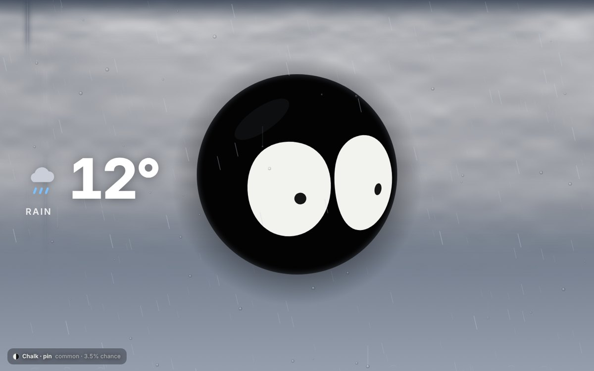
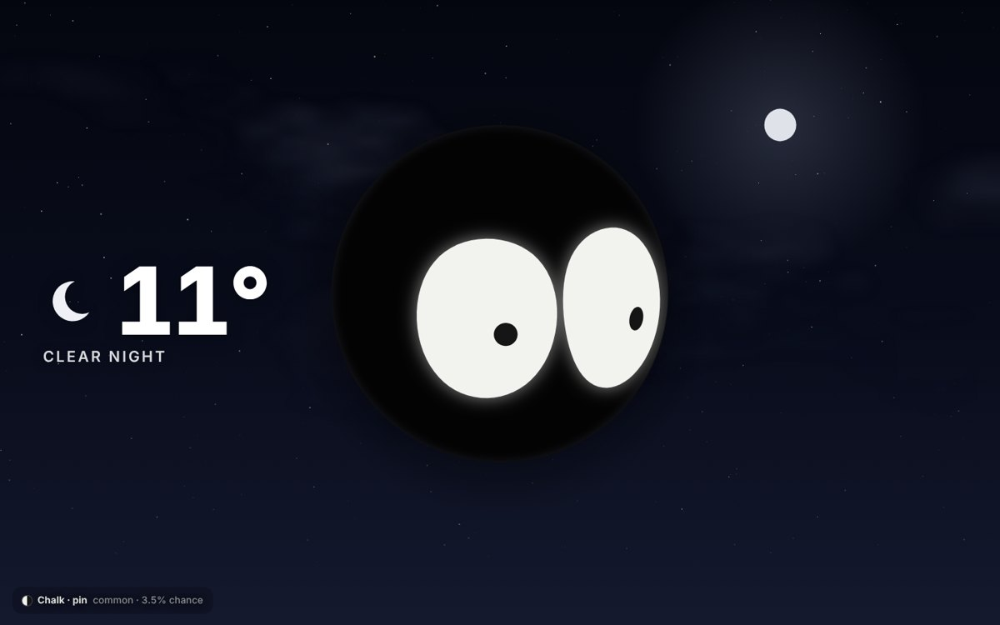

# Weather Eyes

A live wallpaper for macOS. A big black head floats in front of a sky that shows your real weather, and its two eyes follow your cursor around the screen.

## Features

- **Eyes that follow you.** The eyes sit on a turning 3D head, so they slide, tilt and squash as it looks toward your cursor. They blink, wander when you stop moving the mouse, fall asleep after 90 seconds, and wake up when you come back.
- **A new face every day.** Every 24 hours it rolls a new colourway and pupil shape. The current roll and its odds show in the corner.
- **The real sky.** It reads the current weather every 10 minutes from [Open-Meteo](https://open-meteo.com) (free, no account or API key needed).
- **A big temperature readout** with a weather icon on the left.

### Rolls

| Tier | Chance | What you get |
|---|---|---|
| Common | 70% | 20 colourways |
| Rare | 22% | 8 neon colourways |
| Epic | 7% | Odd eyes, a different colour in each eye |
| Legendary | 1% | Prism (colour-cycling), Void (dark eyes, glowing pupils), Galaxy (starry eyes) |

Pupil shapes: round, slit, pin, wide, ring, diamond.

### Weather

| Weather | Sky | Eyes |
|---|---|---|
| Clear | Sun moving across the sky using today's real sunrise and sunset | Small pupils, smaller near the sun |
| Cloudy | Clouds filling as much of the sky as the real cloud cover | Relaxed, slower to follow |
| Rain | Rain as heavy as the real rainfall, slanting with the wind, splashing off the head, drops sliding down the glass | Big pupils |
| Thunderstorm | Lightning inside the clouds and to the ground, thunder shake a moment later | Fast tracking, flinch at every strike |
| Snow | Snowfall that slowly piles up on the head | Shivering |
| Fog | Fog as thick as the real visibility | Big, soft pupils |
| Night | Stars through gaps in the clouds and the real moon phase | Glowing eyes |
| Very windy or near freezing | | Squint |

## Install

You need a Mac running macOS 12 or later and Apple's command line tools. If you don't have the tools, the installer will prompt you to install them.

1. Download or clone this repo.
2. Double-click **Install Weather Eyes.command**.
3. After installation, set your city using the 👀 menu bar icon (see below).
   If macOS says it's from an unidentified developer, right-click it, choose **Open**, then click **Open**.

The installer builds **Weather Eyes.app**, puts it in `~/Applications` and opens it. On macOS 13 or later, the app attempts to register itself to open at login. A 👀 item appears in the menu bar with **Refresh Weather**, **Open at Login** and **Quit**.

Prefer Terminal? Run `./build.sh`, then open the app it builds.

## Choose your weather location

Weather Eyes always displays **real weather**. There is no control to manually
force rain, sunshine, or snow.

### macOS app

1. Click the 👀 icon in your Mac's menu bar.
2. Choose **Set Weather Location…**.
3. Search for a city or suburb and select the correct place from the results.
4. Weather Eyes loads that place's live conditions and remembers it across restarts.

The selected name and coordinates are stored only in your local macOS app
preferences (UserDefaults), not in this GitHub repository. To return to automatic
approximate IP-based location, choose **Use Automatic Approximate Location**.

### Browser

Open the included eyes.html file. For a fixed location, copy
config.example.js to config.js, set your latitude and longitude, and reopen
the page. The file config.js is excluded from Git. Alternatively, the URL
parameters lat and lon can specify a place. Do not publicly share URLs
containing private coordinates.

## Privacy

- This repository does not contain the author's home location or personal address.
- The app sends the chosen coordinates to [Open-Meteo](https://open-meteo.com)
  to retrieve current conditions.
- Searching for a place uses Open-Meteo's public geocoding API.
- With automatic approximate location enabled, IP-based lookup services
  ipapi.co and geojs.io may receive requests; setting a location directly
  avoids those lookups on subsequent app launches.
- The browser version also requests web fonts from Google Fonts.
- Custom local settings, installed app bundles and build output are ignored by Git.

## How it works

- `eyes.html` draws everything on a canvas and fetches the weather.
- `main.swift` is a small macOS app. It puts a borderless window at desktop level on every screen (behind your icons, ignoring clicks), loads `eyes.html` in a web view, and passes it your cursor position 60 times a second.

## License

MIT. See [LICENSE](LICENSE).
